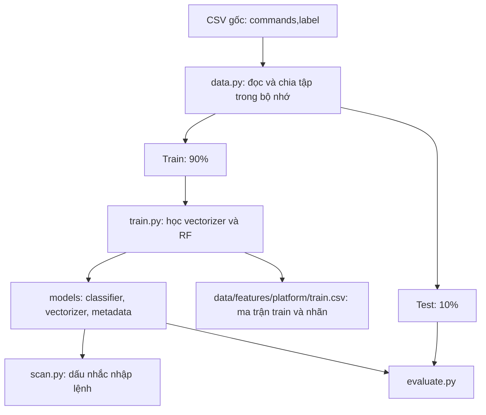
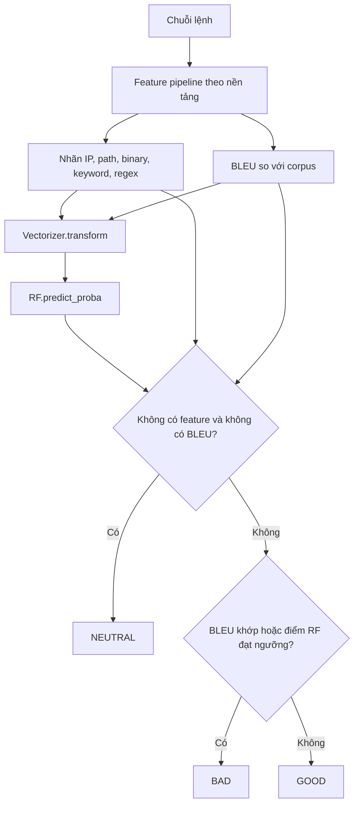

# Luồng hoạt động LotLDetector

Mục tiêu tổ chức là giữ ba thao tác thực nghiệm rõ ràng: **train**, **scan**, **evaluate**. Hướng dẫn chạy nằm trong [README.md](README.md).

## 1. Tổng quan

## 2. Đọc dữ liệu

`load_train_test` trong `src/data.py` chỉ chấp nhận CSV đã có đúng hai cột `commands,label`, nhãn 0/1 và lệnh không rỗng. Không đổi tên cột, đổi nhãn, deduplicate hoặc tự sửa dữ liệu. Sau bước vector hóa, `save_training_dataset` trong cùng module ghi dataset đặc trưng cuối cùng; đây không phải bước làm sạch dữ liệu gốc.

`load_train_test(platform)` chia trực tiếp dữ liệu thành hai DataFrame: train 90% và test 10%, bằng một lần gọi `train_test_split(test_size=0.1, stratify=frame["label"], random_state=42)`. Stratify giữ tỷ lệ nhãn gần với dữ liệu gốc; số mẫu được làm tròn theo scikit-learn.

Không có tập validation trung gian. Cùng dữ liệu, thứ tự dòng và seed sẽ tái tạo cùng tập test. Nếu sửa dữ liệu hoặc cách chia, cần train lại trước khi evaluate; test hiện tại khác tập test của bản chia 80/10/10 trước đây.

Chỉ fit vectorizer và model trên train. Test được quét riêng bằng `evaluate.py`.

## 3. Huấn luyện

`scripts/train.py` gọi `src/models/trainer.py`:

1. Đọc CSV và chia trực tiếp train/test 90/10 qua `load_train_test`.
2. Trích feature phần train với `training=True`, bỏ BLEU.
3. Mẫu BAD không có feature bị bỏ riêng khỏi phần dùng fit; số mẫu bỏ được in ra và lưu trong metadata. Test không lọc theo số feature.
4. Fit `CountVectorizer` trên phần train để tạo ma trận đặc trưng.
5. Ghi đúng ma trận và nhãn chuẩn bị đưa vào RF thành `data/features/{platform}/train.csv`. File có các cột `source_index`, `commands`, `label`, sau đó là các cột `feature:<tên>` theo thứ tự vectorizer. Chỉ số nguồn bắt đầu từ 0; ma trận trong RAM vẫn thưa, CSV được ghi từng hàng.
6. Fit RF 100 cây, trọng số lớp balanced, seed 42 bằng ma trận và nhãn trên.
7. Lưu classifier, vectorizer và metadata gồm cấu hình, hash CSV gốc/dataset đặc trưng/corpus, số mẫu và cách chia `stratified_shuffle` với tỷ lệ train/test 90/10.
8. Chạy `scripts/evaluate.py` riêng để đánh giá toàn bộ test bằng predictor đang dùng cho scan.

Model không tự chọn tham số hoặc tự điều chỉnh threshold. Các script tuning được bỏ khỏi luồng tối giản này. Chỉ lưu một cặp classifier/vectorizer, không tạo thêm bản sao dưới tên cũ `model.classifier2`/`model.vectorizer`.

## 4. Quét một lệnh

`scripts/scan.py` nạp `LotLPredictor(platform)` và nhận lệnh từ dấu nhắc `>>>` hoặc đối số vị trí.

Luật quyết định dùng chung nằm tại `src/models/predictor.py`. CLI chỉ in hai dòng `Extracted features` và `Prediction` giống cách sử dụng libLOL. API giữ các trường `command`, `verdict`, `probability`, `labels` và có `predict_batch` cho danh sách lệnh.

`probability` là điểm RF cho lớp 1, không phải độ tin cậy của toàn bộ kết quả hybrid. Nhãn BLEU không được học trong train nhưng có thể ép BAD khi suy luận.

## 5. Đánh giá test

`scripts/evaluate.py` lấy test qua `load_train_test`, nạp predictor và quét toàn bộ test. Test được tái tạo từ phép chia trực tiếp 90/10, seed 42, giống lúc train. `src/evaluation.py` in classification report, confusion counts và số NEUTRAL, bao gồm số mẫu BAD bị trả NEUTRAL.

Nhờ dùng chung predictor và decision function, kết quả test phản ánh cùng chính sách mà CLI scan sử dụng. Không có bước tự đổi threshold khi evaluate.

## 6. Các thành phần được giữ lại

| Thành phần | Vai trò |
|---|---|
| `preprocessing/normalizer.py` | Tạo chuỗi phân tích Windows có giới hạn và gán nhãn IPv4 |
| `preprocessing/tokenizer.py` | Tách token Windows/Linux |
| `features/rules_constants.py` | Danh sách binary/path/keyword và regex |
| `features/label_generators.py` | Sinh feature từ các danh sách/rule |
| `features/similarity.py` | So BLEU với corpus |
| `features/pipeline.py` | Kết hợp các bộ sinh feature |

Thư mục `preprocessing` xử lý chuỗi lệnh để tạo feature khi train và scan. Đây là logic phát hiện cần thiết; nó khác với script làm sạch và đổi định dạng dataset đã bỏ.

Ngưỡng BLEU vẫn lớn hơn 0,5, candidate dài 6–100 ký tự và có ít nhất 4 token. Ngưỡng RF vẫn là Windows 0,35 và Linux 0,60; số nhãn tối thiểu vẫn là 1. Chính sách mô hình giữ như backup. Predictor nạp ngưỡng đã lưu cùng model, kiểm tra version đặc trưng và hash corpus trước khi dùng.

## 7. Những phần điều chỉnh sau khi khôi phục backup

- Raw CSV giữ nguyên. Chia trực tiếp train/test 90/10, seed 42; chỉ lọc BAD không có feature trong train. Không đưa test vào fit.
- Tám danh sách rule là hợp của Adobe và backup: giữ toàn bộ mục ở cả hai nguồn, bỏ mục trùng hoàn toàn. Những tên nhãn khác nhau nhưng cùng hành vi có thể vẫn tương quan; chưa tự xóa chúng khi chưa có bằng chứng tương đương.
- Giữ nguyên ranh giới biểu thức regex của từng nguồn. Windows dùng IGNORECASE như backup; Linux không dùng cờ này toàn cục để tránh làm sai các biểu thức có phân biệt hoa/thường.
- IP dùng lookaround để không nuốt dấu phân cách, xét reserved/unspecified trước private.
- Corpus BLEU là bản Adobe nguyên gốc; 14 dòng Linux bổ sung riêng của backup được giữ trong bản sao để truy nguyên, không đưa vào nhánh tự ép BAD hiện tại. Không xóa các lệnh tương ứng khỏi raw dataset.
- Giữ tokenizer; thay việc xóa mọi caret bằng các chuỗi phân tích có xét CMD/PowerShell. Giữ nguyên chuỗi gốc, hỗ trợ caret, nháy rỗng trong tên, backtick ngoài chuỗi literal và Base64/UTF-16LE của EncodedCommand; giới hạn 8 chuỗi, 3 bước. Không thực thi nội dung giải mã và không chuẩn hóa Linux bằng quy tắc CMD.
- Nhãn từ các chuỗi được hợp và bỏ trùng trước CountVectorizer. BLEU vẫn dùng tokenizer theo nền tảng và chỉ mục 4-gram/cache, công thức và ngưỡng không đổi. Lệnh Volt Typhoon sưu tầm chỉ dùng thử ngoài dataset huấn luyện, không đưa vào raw CSV hoặc corpus.

Các giới hạn còn tồn tại gồm exact-token binary matching khi có full path, case handling Linux, tokenization mặc định của CountVectorizer và corpus có mẫu trùng test. Cần kiểm chứng riêng trước khi coi hệ thống là bộ quyết định độc hại/an toàn độc lập.
