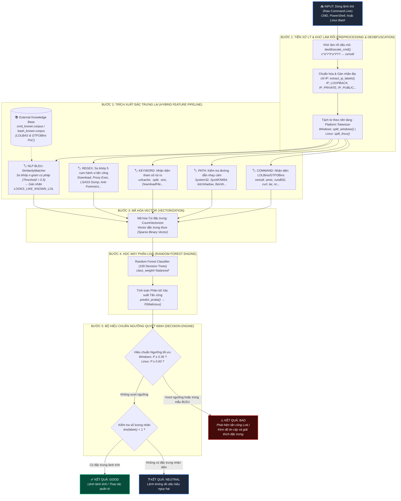
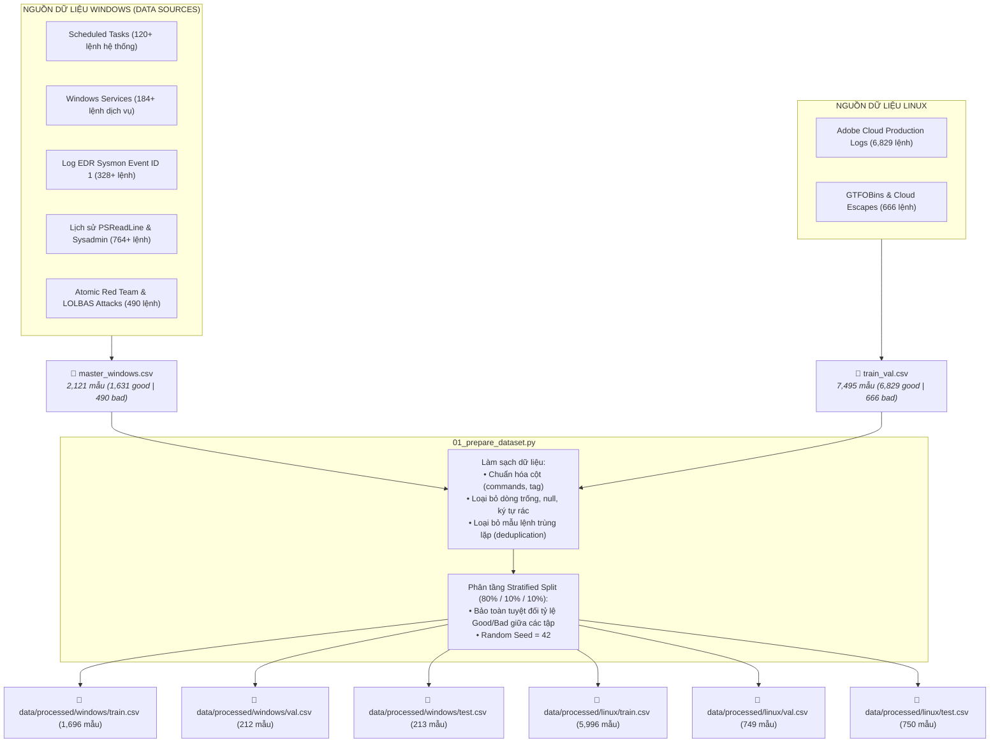
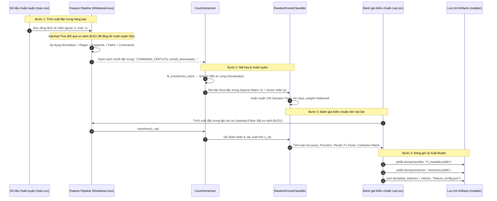
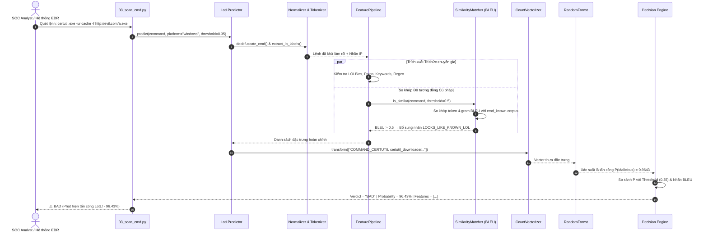
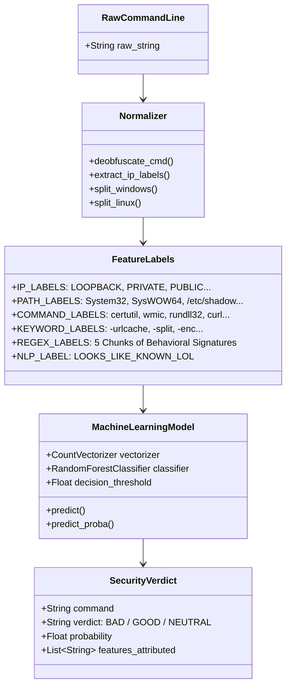

# KIẾN TRÚC VÀ SƠ ĐỒ HOẠT ĐỘNG HỆ THỐNG LOTLDETECTOR
> **Living off the Land (LotL) Attack Detection System using Hybrid Machine Learning & NLP**  
> *Học viện Kỹ thuật Mật mã (KMA) — Đề tài Nghiên cứu Ứng dụng Học máy trong Phát hiện Tấn công Living off the Land*

---

## 1. TỔNG QUAN KIẾN TRÚC TOÀN HỆ THỐNG (HIGH-LEVEL ARCHITECTURE)

Hệ thống **LotLDetector** hoạt động theo mô hình **Kiến trúc Lai (Hybrid Architecture)**, kết hợp giữa:
1. **Quy tắc Chuyên gia & Cẩm nang Tri thức An ninh Toàn cầu** (Expert Rules + Global Domain Knowledge Base: LOLBAS / GTFOBins / MITRE ATT&CK).
2. **Xử lý Ngôn ngữ Tự nhiên & Đo độ tương đồng cú pháp** (NLP: Sentence BLEU token n-gram matching).
3. **Mô hình Học máy Cổ điển Phân tán** (Classical Machine Learning: Tree-based Random Forest Classifier với cơ chế Cân bằng Trọng số Lớp).

---

## 2. QUY TRÌNH TIỀN XỬ LÝ VÀ CHUẨN BỊ DỮ LIỆU (DATA PREPARATION PIPELINE)

Quy trình thu thập, làm sạch và chia tách dữ liệu thực hiện độc lập qua script `scripts/01_prepare_dataset.py`.

---

## 3. QUY TRÌNH HUẤN LUYỆN MÔ HÌNH (MODEL TRAINING PIPELINE)

Thực hiện thông qua `scripts/02_train.py` nạp module `src/models/trainer.py`.

---

## 4. QUY TRÌNH SUY LUẬN & QUÉT THỜI GIAN THỰC (REAL-TIME SCAN INFERENCE)

Thực hiện thông qua `scripts/03_scan_cmd.py` nạp module `src/models/predictor.py`.

---

## 5. PHÂN BỔ BỘ LUẬT VÀ ĐẶC TRƯNG NHẬN DIỆN (FEATURE TAXONOMY)

---

## 6. BẢNG HIỆU NĂNG THỰC NGHIỆM ĐẠT ĐƯỢC (BENCHMARK RESULTS)

Đánh giá hoàn toàn trên tập **Unseen Test Set** (Tập kiểm thử độc lập, không tham gia vào quá trình huấn luyện và điều chỉnh siêu tham số):

| Chỉ số đánh giá | Mô hình Windows (`models/windows`) | Mô hình Linux (`models/linux`) |
| :--- | :---: | :---: |
| **Quy mô tập Test độc lập** | **213 mẫu lệnh** (164 Good, 49 Bad) | **750 mẫu lệnh** (683 Good, 67 Bad) |
| **Độ chính xác toàn diện (Accuracy)** | **95.31%** | **95.47%** |
| **Khả năng bắt tấn công (Recall - Bad)** | **91.84%** *(Bắt trúng 45 / 49 cuộc tấn công)* | **71.64%** *(Bắt trúng 48 / 67 cuộc tấn công)* |
| **Độ chuẩn xác cảnh báo (Precision - Bad)** | **86.54%** *(Ít cảnh báo giả)* | **73.85%** *(Kiểm soát tốt Alert Fatigue)* |
| **F1-Score lớp Tấn công (Minority F1)** | **0.8911** | **0.7273** |
| **Độ chuẩn xác lệnh Lành tính (Good Precision)** | **97.52%** *(157 / 161 lệnh)* | **97.23%** *(666 / 685 lệnh)* |
| **Weighted F1-Score** | **0.9500** | **0.9500** |
| **Ngưỡng quyết định tối ưu ($Th$)** | **0.35** | **0.60** |
| **Cơ chế Tiền xử lý** | Khử làm rối dấu `^`, gán nhãn 7 dải IP | Tokenize POSIX, gán nhãn IP, GTFOBins |
| **Thuật toán ML cốt lõi** | Random Forest (100 cây, class_weight) | Random Forest (100 cây, class_weight) |

